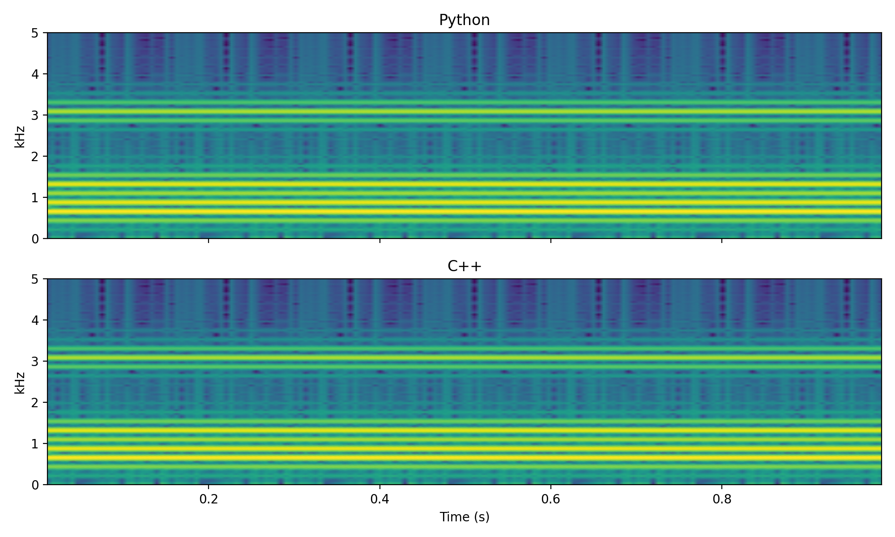

# FOF Vowel Synthesiser (C++)

A single-file C++17 command-line port of my Python [FOF synthesis engine](https://github.com/kyuchia/fof-synthesis),
implementing Rodet's time-domain Formant-Wave-Function (FOF) synthesis.
No dependencies — just the standard library. Outputs 16-bit PCM WAV.

## Build & run

```bash
g++ -std=c++17 -O2 -Wall -Wextra -o fof_synth fof_synth.cpp

./fof_synth --vowel a --f0 220 --dur 1.0 --sr 44100 --out vowel_a.wav
./fof_synth --vowel i --f0 220 --no-vibrato --out vowel_i_flat.wav
./fof_synth --help
```

Options: `--vowel <a|i|u|o>`, `--f0 <Hz>`, `--dur <s>`, `--sr <Hz>`,
`--out <file>`, `--no-vibrato`, `--test-tone`.

## What it does

Each formant is rendered as a repeating FOF grain — an exponentially decaying
sinusoid at the formant centre frequency with a raised-cosine attack:

- attack (0 <= k <= pi/beta): `0.5 * (1 - cos(beta*k)) * exp(-alpha*k) * sin(omega_c*k)`
- decay (k > pi/beta): `exp(-alpha*k) * sin(omega_c*k)`

where `alpha = pi*BW/fs` sets the -6 dB bandwidth and `beta` sets the attack
time (~3 ms). Grains for all formants are overlap-added once per fundamental
period. Grain length is truncated at the T60 decay time.

The fundamental is modulated by a CHANT-style f0 contour: sinusoidal vibrato
(5.5 Hz, 12 cents) plus three-layer block-held random jitter, disabled with
`--no-vibrato`.

Vowel formant data: Mandarin vowels (3 formants) from Chen & Wang (2011).

## Validation against the Python version

Output was verified against the original Python implementation
(same f0, sample rate, vibrato disabled):



Beyond the visual match, an averaged-spectrum comparison of the first 15
harmonics shows the two implementations agree to within 0.04 dB per harmonic
(mean deviation 0.06 dB below 5 kHz) — i.e. numerically equivalent up to
16-bit quantisation.

## Port notes (Python -> C++)

- NumPy vectorised grain synthesis becomes a per-sample loop with explicit
  bounds checking (`operator[]` does not clip like a Python slice).
- Buffers are `std::vector<double>` passed by reference and mixed with `+=`
  (overlap-add).
- Random jitter uses `std::mt19937` + `std::normal_distribution`; the noise
  sequence differs from NumPy's, so jitter is statistically equivalent but
  not bit-identical (validation is therefore done with vibrato disabled).
- dB formant amplitudes from the Python tables are pre-converted to linear.

## References

1. X. Rodet, "Time-Domain Formant-Wave-Function Synthesis," _Computer Music
   Journal_, vol. 8, no. 3, 1984.
2. X. Rodet, Y. Potard, J.-B. Barriere, "The CHANT Project," _Computer Music
   Journal_, vol. 8, no. 3, 1984.
3. H. C. Chen and M. J. Wang, "An Acoustic Analysis of Chinese and English
   Vowels," 2011.
